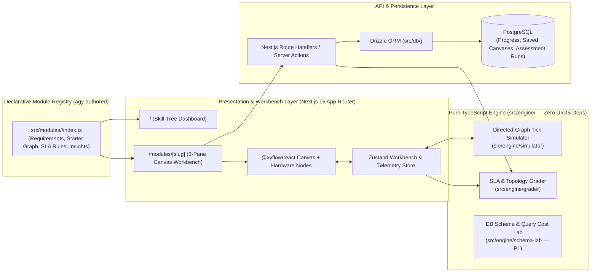
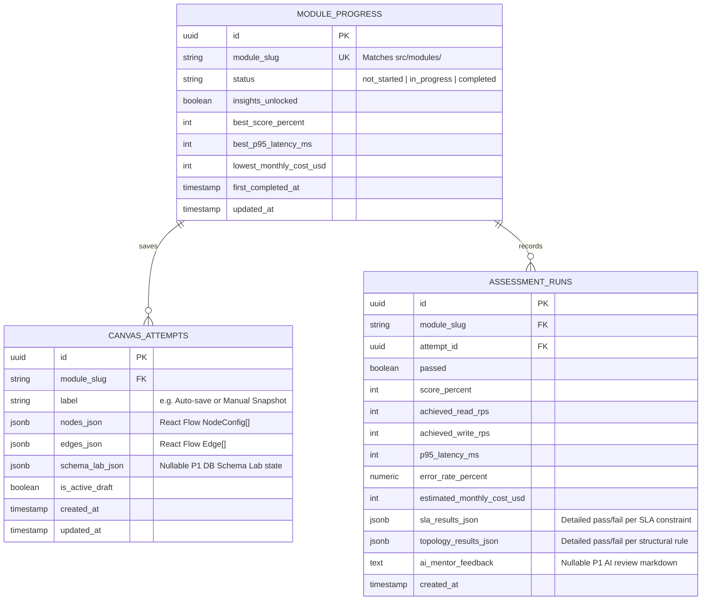
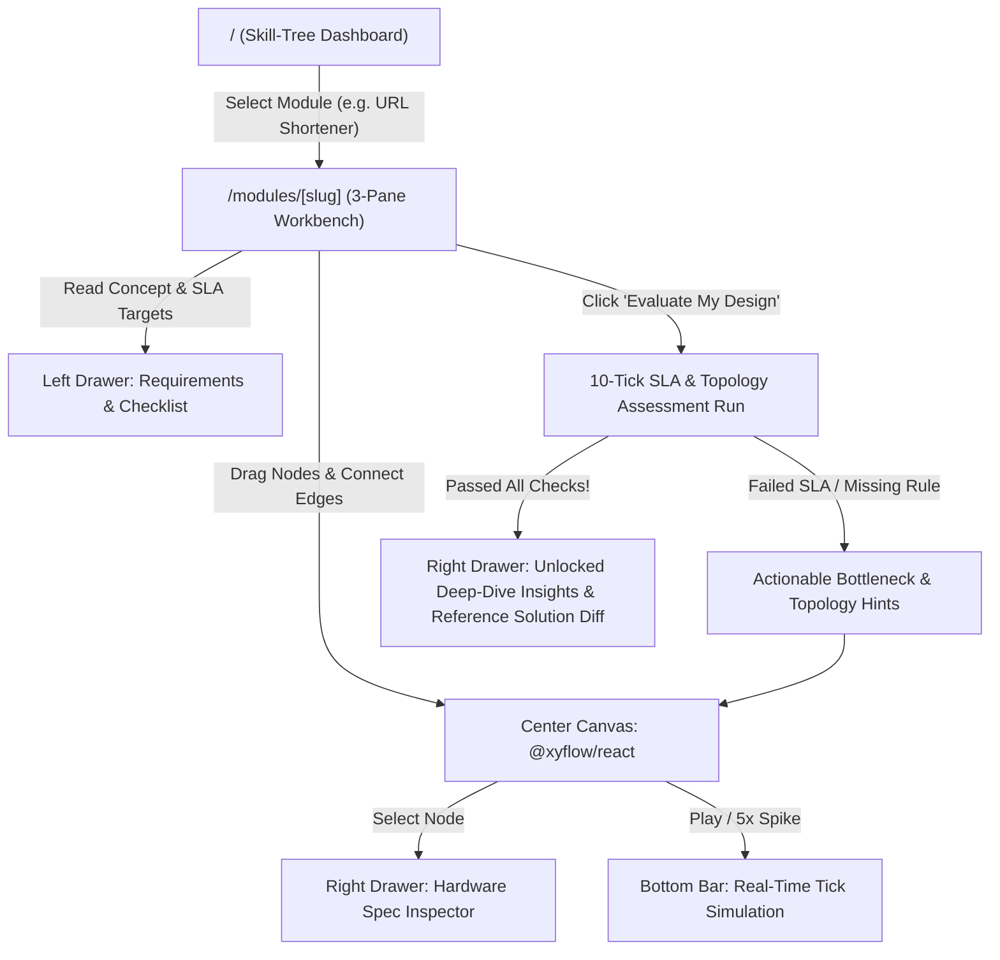
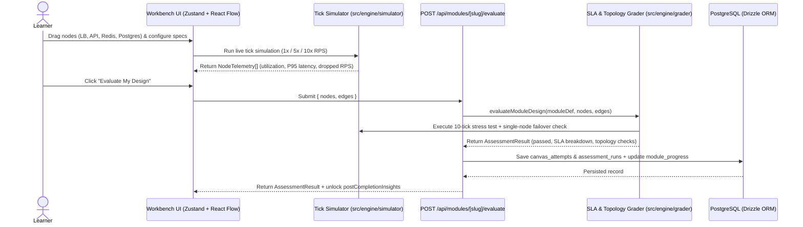

# System Architecture: learn-system32

## 1. High-Level Architecture Diagram



---

## 2. Core Data Model & Schema Specifications

### 2.1 Entity Relationship Diagram (`erDiagram`)



### 2.2 Table Specifications, Indexes, Enums & Constraints

| Table | Enums / Check Constraints | Unique & Composite Indexes | Foreign Key & Cascade Rules | Audit Columns |
|---|---|---|---|---|
| `module_progress` | `status`: `('not_started', 'in_progress', 'completed')`, `best_score_percent BETWEEN 0 AND 100` | `UNIQUE(module_slug)` | — | `first_completed_at` (nullable), `updated_at` |
| `canvas_attempts` | `is_active_draft`: `boolean` | `INDEX(module_slug, is_active_draft, updated_at DESC)` | `module_slug -> module_progress.module_slug ON DELETE CASCADE` | `created_at`, `updated_at` |
| `assessment_runs` | `passed`: `boolean`, `score_percent BETWEEN 0 AND 100` | `INDEX(module_slug, created_at DESC)` | `module_slug -> module_progress.module_slug ON DELETE CASCADE`, `attempt_id -> canvas_attempts.id ON DELETE SET NULL` | `created_at` |

### 2.3 Declarative Module Contract (`src/modules/<slug>/index.ts`)
Every module created by `agy` in `src/modules/<slug>/` adheres to the following pure-TypeScript contract (`src/engine/types.ts`):
- **`metadata`**: `slug`, `title`, `subtitle`, `tier` (`'tier-1-foundations' | 'tier-2-async' | 'tier-3-distributed'`), `order`, `difficulty` (`'Beginner' | 'Intermediate' | 'Advanced'`), `estimatedMinutes`, `tags`.
- **`conceptBrief`**: Problem context, back-of-the-envelope numbers (Read RPS, Write RPS, payload size, storage growth), and key mental models.
- **`requirements`**: Functional requirements list, non-functional requirements list, and `sla: LevelSLAConstraints`.
- **`starterGraph`**: Initial `nodes: CanvasNode[]` and `edges: CanvasEdge[]` plus `allowedNodeTypes?: NodeCategory[]`.
- **`topologyRules`**: Array of deterministic structural validation rules (`id`, `description`, `validate(nodes, edges) => { passed: boolean; reason?: string }`).
- **`referenceSolution`**: Optimal `nodes`, `edges`, and step-by-step explanation of why the reference architecture passes all SLAs.
- **`postCompletionInsights`**: Deep-dive architectural sections (`title`, `markdownContent`, `realWorldExamples`, `commonAntiPatterns`, `interviewTakeaways`).

---

## 3. High-Level API Endpoints Summary

| Feature ID | Method | Path | Query Params (Optional) | Auth | Summary Description |
|---|---|---|---|---|---|
| `FEAT-01` | `GET` | `/api/modules` | `?tier=&status=` | Local (None) | Lists all auto-discovered `src/modules/` merged with PostgreSQL `module_progress`. |
| `FEAT-01` | `GET` | `/api/modules/[slug]` | None | Local (None) | Returns full module definition, active draft canvas from `canvas_attempts`, and recent `assessment_runs`. |
| `FEAT-03` | `PUT` | `/api/modules/[slug]/draft` | None | Local (None) | Upserts the learner's active React Flow canvas (`nodes_json`, `edges_json`) and sets progress to `in_progress`. |
| `FEAT-03` | `POST` | `/api/modules/[slug]/reset` | None | Local (None) | Resets the active draft canvas back to the module's `starterGraph`. |
| `FEAT-04` | `POST` | `/api/modules/[slug]/evaluate` | None | Local (None) | Runs the deterministic 10-tick stress simulator + topology grader, records an `assessment_runs` row, and unlocks `postCompletionInsights` if `passed === true`. |
| `FEAT-07` | `POST` | `/api/modules/[slug]/ai-review` | None | Local (None) | *(P1)* Streams an AI Architecture Mentor critique using Vercel AI SDK (`@ai-sdk/google` / OpenAI). |

---

## 4. Frontend Layout Shell, Route Summary & Navigation Flow

### 4.1 App Layout Shell & Theme Strategy
- **Primary Layout Shell:**
  - **Dashboard (`/`)**: Top header bar (platform stats, completed modules count, tier filter) + progressive skill-tree grid organized by Tier 1, Tier 2, and Tier 3.
  - **Interactive Workbench (`/modules/[slug]`)**: Full-viewport (`100dvh`) 3-pane engineering workbench:
    - **Top Workbench Header:** Back to Dashboard link, Module Title & Difficulty Badge, live Monthly Cost vs. Budget counter, and `Evaluate My Design` primary CTA.
    - **Left Collapsible Drawer (340px):** Tabs for `Concept & Requirements`, `SLA & Topology Checklist`, and `Assessment History`.
    - **Center Interactive Canvas (`flex-1`):** `@xyflow/react` infinite canvas with floating Top-Left Hardware Node Palette and floating Bottom Simulation Control Bar (`Play/Pause`, `Step 1 Tick`, `Traffic Multiplier: 1x | 5x | 10x`, `Auto-Layout`).
    - **Right Collapsible Drawer (380px):** Tabs for `Node Hardware Inspector` (instances, tier, cache hit ratio, read replicas, sharding) and `Post-Completion Insights & Reference Architecture` (unlocked upon passing or via Hint toggle).
- **Theme & Styling:** Dark engineering theme (`slate-950` canvas grid, emerald/amber/rose status telemetry badges) built with **Tailwind CSS** and **shadcn/ui** components.

### 4.2 High-Level Screen & Route Inventory

| Feature ID | Screen / Route | Access Level | State / Data Strategy | Summary Purpose |
|---|---|---|---|---|
| `FEAT-01` | `/` | Local (Public) | Next.js Server Component + Drizzle query | Progressive system design skill tree, module cards, completion badges, and SLA high scores. |
| `FEAT-03` / `04` / `05` | `/modules/[slug]` | Local (Public) | Hybrid SSR initial load + `Zustand` live workbench store | Interactive React Flow architecture simulator, hardware inspector, SLA assessment grader, and unlocked deep-dive insights. |

### 4.3 Page Navigation & User Flow Diagram



---

## 5. Critical Execution Flow (`sequenceDiagram`)



---

## 6. Technology Stack Matrix & Folder Layout

| Layer | Chosen Technology | Rationale |
|---|---|---|
| **Project Scope** | Mode C — Application Code Only (Modular Full-Stack Next.js) | Local-first personal learning platform without auth walls or DevOps bloat, ready for future cloud deployment. |
| **Frontend Framework & UI** | Next.js 15+ (App Router, React 19, TypeScript) + Tailwind CSS + shadcn/ui | Unified full-stack TypeScript workflow with rich dark-mode engineering UI primitives. |
| **Interactive Canvas & Layout** | `@xyflow/react` (React Flow v12) + `@dagrejs/dagre` + `lucide-react` | Industry-standard node-graph canvas with custom hardware node badges, animated traffic edges, and auto-layout. |
| **State Management** | `Zustand` | High-frequency tick simulation updates without full React tree re-renders; clean separation of canvas state and simulation telemetry. |
| **Simulation & Grading Engine** | Pure TypeScript (`src/engine/`) | Zero dependency on React or Next.js so it can be unit-tested in isolation and extracted into an Nx package anytime. |
| **Database & ORM** | PostgreSQL + Drizzle ORM (`drizzle-orm`, `drizzle-kit`, `pg`) | Type-safe SQL queries and `JSONB` storage for React Flow graphs and assessment telemetry snapshots. |
| **AI Integration (P1)** | Vercel AI SDK (`ai`, `@ai-sdk/google`) | Clean streaming architecture critiques for the P1 AI Mentor feature. |
| **Testing & Verification** | Vitest (Unit tests for `src/engine/simulator` & `src/engine/grader`) + Drizzle DB Seed | Balanced verification ensuring deterministic math and grading rules are 100% reliable. |

```text
learn-system32/
├── docs/
│   ├── PRD.md                           # Product vision & Master Feature Registry
│   ├── ARCHITECTURE.md                  # System diagram, DB schema, APIs & UI navigation
│   ├── SIMILAR_PRODUCT.md               # Reference specification (sys0.in inspiration)
│   ├── adr/                             # Architecture Decision Records
│   └── tasks/                           # Master Task Index & microtask specs
├── src/
│   ├── engine/                          # Pure TypeScript Engine (Zero React/Next/DB imports)
│   │   ├── types.ts                     # Core HardwareSpec, NodeConfig, NodeTelemetry, LearningModule types
│   │   ├── simulator/                   # Topological traffic propagation & M/M/1 latency calculator
│   │   ├── grader/                      # 10-tick SLA stress evaluator & structural topology rule checker
│   │   └── schema-lab/                  # (P1) DB schema AST & query cost analyzer
│   ├── modules/                         # Auto-discovered learning modules authored by agy
│   │   ├── index.ts                     # Central module registry loader & sorter
│   │   ├── 01-single-server-bottleneck/ # Foundational module 1
│   │   │   └── index.ts
│   │   └── 02-url-shortener/            # Real-world system design module (Bitly-style URL Shortener)
│   │       └── index.ts
│   ├── db/                              # PostgreSQL + Drizzle ORM layer
│   │   ├── index.ts                     # Database connection pool
│   │   ├── schema.ts                    # module_progress, canvas_attempts, assessment_runs tables
│   │   └── seed.ts                      # Syncs initial module_progress rows from src/modules/
│   ├── store/                           # Client state
│   │   └── use-workbench-store.ts       # Zustand store for React Flow graph, active tick & telemetry
│   ├── components/
│   │   ├── ui/                          # shadcn/ui primitives
│   │   ├── dashboard/                   # Skill-tree cards, tier filters, progress stats
│   │   └── canvas/                      # HardwareNode, AnimatedTrafficEdge, NodeInspector, SimControlBar
│   └── app/
│       ├── layout.tsx                   # Root dark engineering theme layout
│       ├── page.tsx                     # / (Skill-Tree Dashboard)
│       ├── modules/[slug]/page.tsx      # /modules/[slug] (Interactive Workbench)
│       └── api/modules/                 # Route handlers for saving drafts & running assessments
├── tests/
│   └── engine/                          # Vitest unit tests for simulator & grader
├── AGENTS.md                            # Agent workflow rules & module authoring guide
├── .env.example                         # Environment variable template
├── drizzle.config.ts                    # Drizzle Kit configuration
└── package.json
```
